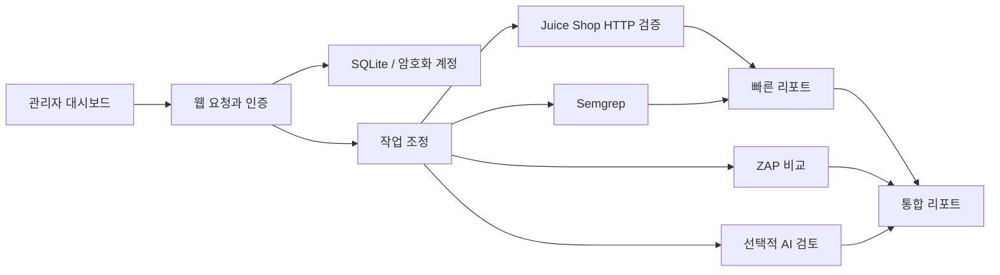

# 구조와 설계

## 흐름

- config.py: 설치 위치와 분리된 데이터·소스 경로. cwd/.local 또는 명시적 환경변수.
- dashboard.py: 앱 조립, 작업·설정·보고서 경로.
- web/auth.py: 로그인·세션·CSRF·속도 제한·보안 헤더.
- web/targets.py: 허용 대상·소스·계정 입력 검증.
- store.py: SQLite 연결/트랜잭션 수명, 암호화 저장, 작업 저장.
- jobs.py: 제한된 작업 큐, 설정 스냅샷, 병렬 작업 수집, 실패 분류, 보고서 생성 시점.
- ai/context.py: 제한된 소스 선별과 근거 식별.
- ai/providers.py: Ollama와 공식 CLI 추론 차이를 숨기는 연결 모듈.
- ai/__init__.py: 근거 검증 및 검토→반론→통합 흐름.
- integrated_report.py + templates/: 결과 렌더링, 자동 HTML escaping.
- setup.py: 고정 소스·이미지 설치, 기존 컨테이너 보존.
- lab/: 평가용 의도적 취약 구현. 운영 코드의 보안 기준으로 재사용하지 않음.

## 유지할 불변식

작업 상태는 조정 스레드만 변경합니다. 분석 작업은 결과를 반환하고 공유 job 객체를 직접 수정하지 않습니다.
AI 설정은 작업 등록 시 스냅샷으로 저장해 대기 중 설정 변경에 영향받지 않습니다.
빠른 보고서는 DAST와 SAST 종료 후 한 번 생성되고 AI 결과로 덮어쓰지 않습니다.
통합 보고서는 요청한 모든 작업의 terminal 상태 이후 생성합니다.
AI 가설과 도구 경고는 confirmed 수에 합산하지 않습니다.
검증 불가능한 사례는 안전으로 간주하지 않습니다.
암호화 계정정보와 CLI 인증 토큰은 AI 프롬프트나 공개 저장소에 포함하지 않습니다.

SQLite 연결은 context manager가 commit/rollback과 close를 모두 수행합니다.
JSON 작업 스냅샷은 임시 파일 교체로 저장합니다.
새 앱을 지원하려면 별도 정상 대조·권한 모델·성공 판정이 필요합니다. URL 허용만으로 일반 DAST가 되지는 않습니다.
